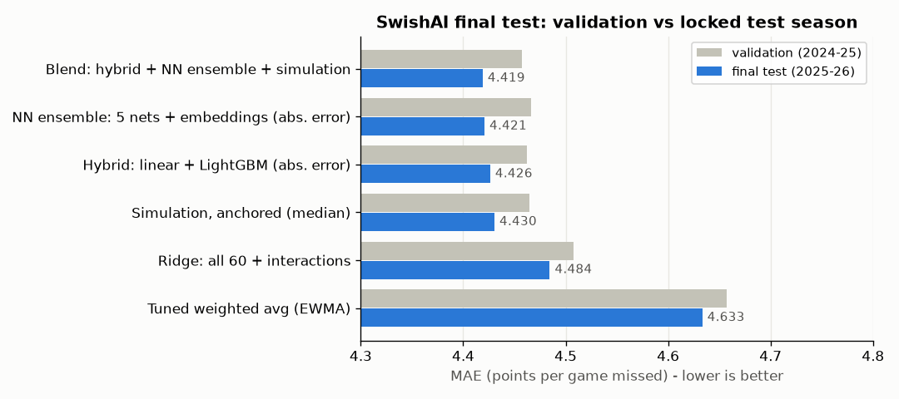

# SwishAI 🏀


**SwishAI predicts how many points an NBA player will score in his next game.**
For any player it gives one predicted number, an 80% range, and probabilities such as
"P(20+ points)" or "P(over 18.5)".

The project goes step by step from simple averages to linear regression, decision trees,
gradient boosting, a Monte Carlo game simulation and neural networks. The core
algorithms (linear regression, decision trees, gradient boosting, and a neural network with
backpropagation) are **written from scratch in NumPy** and checked against the standard
libraries.

**Highlights**
- **Leakage-proof:** 68 pre-game features from 131K player-games, with a test that proves no
  feature looks at its own game or the future.
- **36% lower error** than guessing the league average on a locked held-out season
  (6.92 → 4.42 points MAE), by blending LightGBM, a neural-net ensemble and a Monte Carlo
  game simulation.
- **Honest uncertainty:** 80% ranges contained 80.4% of real test games.
- **Running live:** a daily pipeline predicts every player before tip-off, grades itself and
  explains its misses. 5,561 graded 2026-27 predictions average **4.40 MAE**, in line with the
  test season ([live report](tracking/REPORT.md)).

```text
$ python -m src.predict "Dylan Harper" --line 18.5
==============================================================
 SwishAI forecast: Dylan Harper (SAS) @ PHX, 2026-11-09
==============================================================
 Last 5 games:        13, 19, 21, 17, 25  (most recent first)
 ...
--------------------------------------------------------------
 PREDICTION:          15.5 points
 80% range:           7 - 27 points
   P(20+ points)      30.9%
 P(over 18.5):        35.0%
==============================================================
```

---

## Table of contents
1. [Results](#results)
2. [How it works (overview)](#how-it-works-overview)
3. [Project structure](#project-structure)
4. [Phase 0: Getting the data](#phase-0-getting-the-data)
5. [Phase 1: Exploratory analysis](#phase-1-exploratory-analysis)
6. [Phase 2: Feature engineering](#phase-2-feature-engineering-68-pre-game-features)
7. [The no-leakage test](#the-no-leakage-test)
8. [Phase 3: The evaluation harness](#phase-3-the-evaluation-harness)
9. [Phase 4: Baselines](#phase-4-baselines)
10. [Phase 5: Linear regression from scratch](#phase-5-linear-regression-from-scratch)
11. [Phase 6: Distribution models](#phase-6-distribution-models)
12. [Phase 7: Trees and gradient boosting](#phase-7-trees-and-gradient-boosting)
13. [Phase 8: Monte Carlo game simulation](#phase-8-monte-carlo-game-simulation)
14. [Phase 9: Neural networks](#phase-9-neural-networks)
15. [Phase 10: Blend, final test, live forecasts](#phase-10-blend-final-test-and-live-forecasts)
    - [Phase 11: The daily loop](#phase-11-the-daily-loop-predict-grade-learn)
16. [Using the predictor](#using-the-predictor)
17. [Installation and running everything](#installation-and-running-everything)
18. [Key lessons and limitations](#key-lessons-and-limitations)

---

## Results

All models were scored on the **2025-26 season**, which was locked away and used for nothing
until the very end (about 26,000 player-games). MAE is the average number of points the
prediction was off by.

| Model | Validation MAE (2024-25) | **Test MAE (2025-26)** |
|---|---|---|
| League average for everyone | 7.046 | 6.917 |
| Best simple baseline (tuned weighted recent average) | 4.658 | 4.633 |
| Ridge regression, 60 features + interactions | 4.507 | 4.484 |
| Hybrid: linear regression + LightGBM | 4.462 | 4.426 |
| Ensemble of 5 neural networks + player embeddings | 4.467 | 4.421 |
| Monte Carlo simulation (median) | 4.465 | 4.430 |
| **Final blend (hybrid + neural nets + simulation)** | **4.458** | **4.419** |



- **36% lower error** than guessing the league average, and **4.6% lower** than the best
  common-sense baseline.
- Error by player type on the test season (final blend): bench players (<10 ppg) **3.64**,
  mid-tier (10-20 ppg) **5.15**, stars (20+ ppg) **6.22** points.
- **The ranges are honest:** the simulation's 80% ranges contained **80.4%** of real test
  games.
- Validation and test scores are close, so the model was not overfit to the season used for
  tuning.

### Live season (2026-27, through November 24)

The daily loop ([Phase 11](#phase-11-the-daily-loop-predict-grade-learn)) predicts every
player before tip-off and grades the picks once the games finish. Games played before the
loop started were filled in afterwards, using only pre-game data.

| Predictions | Player-games | Blend MAE | No-ML weighted average | Inside the 80% range |
|---|---|---|---|---|
| All graded (live + filled in) | 5,561 | **4.40** | 4.82 | 83% |
| Live only (made before tip-off) | 1,293 | **4.48** | 4.66 | 84% |

Live picks score a little worse because they must also guess the lineup: 12% of players
expected to play sat out. The latest numbers are in [`tracking/REPORT.md`](tracking/REPORT.md).

### Version 2 (November 2026): 8 features added by the daily review

The table above is **version 1** (60 features), scored once on the locked 2025-26 season.
The daily loop (Phase 11) then graded the first four weeks of 2026-27 and found the model
too high for three groups. The cause: teams use deeper rotations early in a season
(11.2 players a game versus 10.6 later), and the model had no input for season timing, a
player's own absences or rotation depth. Eight features were added (marked v2 in Phase 2).

| Check | Version 1 | Version 2 | Change |
|---|---|---|---|
| Validation 2024-25, blend MAE | 4.458 | 4.451 | -0.007 (uncertainty 0.002) |
| Validation, first 4 weeks only | 4.492 | 4.478 | -0.014 |
| 2026-27 so far, 4,173 unseen games | 4.445 | 4.415 | -0.030 (uncertainty 0.006) |

Version 2 has **not** been scored on the locked 2025-26 test season; the features were chosen
on validation and confirmed on 2026-27 only. Two league-wide "scoring climate" features were
also tried and dropped because they added nothing. The version 1 model and its prediction
record are kept in `models/` and `tracking/archive/`.

---

## How it works (overview)

```text
 stats.nba.com ──► fetch_data.py ──► data/raw/*.parquet  (131K player-games, 5 seasons)
                                           │
                                           ▼
                                    features.py  ──►  68 pre-game features per player-game
                                           │          (tested by tests/test_no_leakage.py)
                                           ▼
                                    evaluate.py  ──►  one scoring method for every model
                                           │
     ┌──────────────┬──────────────┬───────┴──────┬────────────────┬───────────────┐
 baselines       linear      distributions      trees         simulate       neural_net
                                           │
                                           ▼
                                  blend.py  (0.5 hybrid + 0.4 neural nets + 0.1 simulation)
                                           │
                     ┌─────────────────────┴─────────────────────┐
              final_test.py                                   predict.py
         (one-time score on 2025-26)              (forecasts for the current 2026-27 season)
```

**The golden rule: no peeking at the future.** Every feature for a game is built only from
games played *before* tip-off, and the data is split **by season**, never randomly. A model
that sees even a bit of the game it is predicting looks great in testing and fails in real
use. SwishAI includes a test that proves this can't happen (see
[the no-leakage test](#the-no-leakage-test)).

**Time-based split** (set in `src/config.py`):

| Role | Seasons | Used for |
|---|---|---|
| Train | 2021-22, 2022-23, 2023-24 | Models learn from these |
| Validation | 2024-25 | Every design choice (features, settings, blend weights) |
| Test | 2025-26 | Scored **once**, at the very end |
| Live | 2026-27 | Real forecasts; downloaded daily, never trained on |

---

## Project structure

```text
SwishAI/
├── src/
│   ├── config.py              # seasons, train/valid/test split, folder paths
│   ├── fetch_data.py          # Phase 0: download game logs from stats.nba.com
│   ├── features.py            # Phase 2: build the 68 leakage-free features
│   ├── evaluate.py            # Phase 3: shared scoring harness + leaderboard
│   ├── final_test.py          # Phase 10: one-time test on 2025-26
│   ├── predict.py             # Phase 10: command-line forecaster
│   ├── daily.py               # Phase 11: automatic daily predict / grade / learn loop
│   ├── review.py              # Phase 11: scoreboard, adaptive weights, error diagnosis, report
│   └── models/
│       ├── baselines.py       # Phase 4: averages, minutes x rate, tuned EWMA
│       ├── linear.py          # Phase 5: linear/ridge regression from scratch
│       ├── distributions.py   # Phase 6: Normal and Negative Binomial outcome distributions
│       ├── trees.py           # Phase 7: tree + boosting from scratch, Random Forest, LightGBM
│       ├── simulate.py        # Phase 8: Monte Carlo minutes → shots → makes simulation
│       ├── neural_net.py      # Phase 9: NumPy MLP, PyTorch wide & deep, embeddings, ensembles
│       └── blend.py           # Phase 10: weighted blend of the best models
├── tests/
│   └── test_no_leakage.py     # proves no feature looks at its own game or the future
├── notebooks/                 # 01_eda … 06_neural_networks: charts and walkthroughs
├── results/                   # leaderboard.csv, final_test.csv, charts
├── tracking/                  # live record: predictions.csv, decisions.csv, REPORT.md
├── data/                      # (not in git) raw + processed data, re-created by the scripts
├── models/                    # (not in git) saved trained blend
└── requirements.txt
```

---

## Phase 0: Getting the data
**File:** `src/fetch_data.py`

Uses the free [`nba_api`](https://github.com/swar/nba_api) package to download from
stats.nba.com, for each of five regular seasons (2021-22 to 2025-26):

1. **Player game logs**: one row per player per game (minutes, shots, free throws, rebounds,
   points, …). About 131,000 player-games in total.
2. **Team game logs**: one row per team per game, used for team strength, pace and opponent
   defense.
3. **Player ages**: one row per player per season.

Each table is saved as a Parquet file in `data/raw/`. The script retries failed requests up to
3 times with growing waits, pauses between calls to go easy on the NBA servers, and skips
files it has already downloaded, so it's safe to re-run.

---

## Phase 1: Exploratory analysis
**Notebook:** `notebooks/01_eda.ipynb`

Before modeling, the data was explored to learn what drives scoring:
- **Minutes drive scoring.** Points are mostly playing time × scoring rate.
- **The leakage trap.** Same-game stats (shots taken, minutes played) predict points almost
  perfectly, but you can't know them before the game. They must never be used as features.
- **The noise floor.** Even stars swing ±7 points from game to game, which limits how
  accurate *any* model can be.
- Rows where a player was listed but played 0 minutes are removed.

---

## Phase 2: Feature engineering (68 pre-game features)
**File:** `src/features.py` → output `data/processed/features.parquet`

This turns raw logs into one table: **one row per player per game**, with features (what we
could know before tip-off) and the target `PTS`. Every rolling stat is computed after
`.shift(1)`, which moves a player's history down one row, so row *N* only sees games
1…*N*-1.

| Group | Features | What they capture |
|---|---|---|
| **Recent form** | `PTS/MIN/FGA/FG3A/FTA` averages over the last 3, 5, 10 and 30 games and season to date (25 features) | How much he's been playing and shooting lately |
| **Weighted averages** | `PTS_EWM5/10/20` | Exponentially weighted points: every past game counts, recent ones count more |
| **Consistency** | `PTS_STD_L10` | How streaky his scoring has been |
| **Scoring skill** (last 20 games) | `TS_PCT_L20` (true shooting), `FT_PCT_L20`, `FG3_RATE_L20` (share of shots that are 3s), `FT_RATE_L20` (free throws per shot), `PTS_PER_MIN_L20` | Efficiency and shot profile |
| **Usage** | `USG_L10` | His share of team plays (shots + free throw trips + turnovers) while on the floor |
| **Role** | `TEAM_MIN_RANK`, `TEAM_PTS_RANK` | Rank among tonight's teammates by recent minutes and points (1 = top role) |
| **Fouls** | `PF_PER36_L10` | Foul trouble risk (less playing time) |
| **Rest and availability** | `REST_DAYS`, `BACK_TO_BACK`, `TEAM_GAMES_MISSED` | Fatigue and players coming back from absences |
| **Experience** | `GAMES_WITH_TEAM`, `GAMES_PLAYED_BEFORE`, `AGE` | New trades/signings, how much history we have |
| **Venue** | `HOME` | Home vs. away |
| **Own team** | `TEAM_OFF_RTG`, `TEAM_PACE`, `TEAM_NET_RTG` | Team offense, speed and overall strength |
| **Opponent** | `OPP_DEF_RTG`, `OPP_OFF_RTG`, `OPP_PACE`, `OPP_NET_RTG`, `OPP_3PA_RATE_ALLOWED`, `OPP_FTA_RATE_ALLOWED` | How good the defense is and what it gives up |
| **Blowout risk** | `NET_RTG_GAP`, `ABS_NET_RTG_GAP` | A big gap in strength makes it likely starters sit in the 4th quarter |
| **Who's missing** | `TEAMMATES_OUT_PTS/MIN`, `OPP_PLAYERS_OUT_PTS/MIN` | Points and minutes of regular players sitting out tonight, on both teams |
| **Season timing** (v2) | `SEASON_GAME_NUM`, `TEAM_GAME_NUM` | How far into the season we are: early on, averages still reflect last season and rotations are deeper |
| **Role changes** (v2) | `MIN_LAST`, `MIN_TREND`, `TEAM_PLAYERS_USED_L5` | Minutes in his last game, whether his minutes are rising or falling, and how many players his team uses |
| **His own absences** (v2) | `TEAM_REST_DAYS`, `PLAYER_EXTRA_REST`, `GAMES_SINCE_RETURN` | Separates the team's days off from games he sat out, and counts games since he came back |

**How a few of these are built:**
- **Team ratings** use possessions estimated as `FGA + 0.44·FTA − OREB + TOV` (averaged over
  both teams). Offensive and defensive ratings are points per 100 possessions. Pace is
  possessions per 48 minutes, corrected for overtime. All ratings are exponentially weighted
  averages (span 15) of *previous* games, so they carry over from last season early in a season.
- **"Who's missing"**: a player counts as a *regular* if he played in one of the team's last
  5 games. If a regular isn't playing tonight, his last-10-game points and minutes are added
  to `TEAMMATES_OUT_*` (or `OPP_PLAYERS_OUT_*`). Teams announce inactive players before
  tip-off, so this is fair to use.
- **Simulation inputs** (6 extra columns, used only by Phase 8): 2-pt, 3-pt and free-throw
  attempts *per minute* and make rates over the last 50 games. Make rates are **shrunk toward
  the league average** (53% / 36% / 78%) by pretending he also took 50 / 150 / 30
  league-average shots. A 4-for-5 three-point shooter is not really an 80% shooter (a simple
  Bayesian idea).

---

## The no-leakage test
**File:** `tests/test_no_leakage.py`

This test proves the golden rule holds:
1. Build all features normally.
2. Pick a random date and **scramble everything that happened on or after it**: every
   box-score stat for players *and* teams is replaced with random numbers.
3. Rebuild the features.
4. For games **on** that date, all 74 columns (68 features + 6 simulation inputs) must be
   **exactly the same**. If one changed, it was peeking at its own game or the future. The
   target `PTS` *should* change, which shows the scramble really happened.

This is repeated for 5 random dates. Who played is kept the same, since inactive lists are
public before the game.

---

## Phase 3: The evaluation harness
**File:** `src/evaluate.py`

Every model, from "league average" to the neural network ensemble, is scored by **one
function**, `evaluate(model, name, split)`. A model is any object with `fit(train_df)` and
`predict(df)`. The harness:
- Loads the feature table and keeps only rows where the player has **≥5 previous games**.
- Splits by season (`"valid"`: train 2021-24 → score 2024-25; `"test"`: train 2021-25 →
  score 2025-26).
- Checks that predictions have the right length and contain no NaNs.
- Reports **MAE** (main metric), **RMSE** (punishes big misses), **bias** (do we guess too
  high or low on average) and **R²** (share of game-to-game variation explained).
- Breaks MAE down by **player tier**: bench (<10 ppg), mid (10-20), star (20+).
- Saves every result to `results/leaderboard.csv`. `show_leaderboard()` prints them, best
  first.

---

## Phase 4: Baselines
**File:** `src/models/baselines.py`

Baselines answer: *how good can you get with plain common sense?* Every ML model has to beat
these.

| Baseline | Idea |
|---|---|
| `LeagueAverage` | Same number for everyone (the "know nothing" floor) |
| `ColumnBaseline` | Use one average directly, e.g. last-10 or season average |
| `MinutesTimesRate` | Expected minutes (last 10) × points per minute (last 20) |
| `TunedEWMA` | Exponentially weighted average, with the fade speed (span 5/10/20) **chosen on training data** (the first bit of learning in the project) |

Best baseline: tuned EWMA, **4.658** validation MAE. Chart: `results/baselines_valid.png`.

---

## Phase 5: Linear regression from scratch
**File:** `src/models/linear.py` · **Notebook:** `02_linear_regression.ipynb`

`predicted_points = w0 + w1·x1 + … + wk·xk`, where the weights are learned by minimizing
squared error.

- **`Preprocessor`**: fills blanks with the training median, then **standardizes** each
  feature to mean 0 and spread 1, using training statistics only.
- **Two solvers, written by hand:**
  - **Normal equation**: `w = (XᵀX)⁻¹Xᵀy`. Exact, one step.
  - **Gradient descent**: start at zero and repeatedly step against the gradient. This is the
    method that scales to neural networks.
- **Ridge regularization**: adds `λ·Σw²` so the model can't lean too hard on any one of the
  many correlated averages. λ is tuned over a grid.
- **Hand-made interaction features**: a linear model can only *add* effects, but some
  *multiply*:
  - star × bad defense (`PTS_EWM20 × OPP_DEF_RTG`)
  - star × fast pace
  - ball-dominant player × teammates out (`USG_L10 × TEAMMATES_OUT_PTS`)
  - minutes × scoring rate
  - star × blowout risk
- **Verified against scikit-learn**: the from-scratch weights match to about **1e-12**.

Result: Ridge with all 60 features + interactions: **4.507** validation MAE.

---

## Phase 6: Distribution models
**File:** `src/models/distributions.py` · **Notebook:** `03_distributions.ipynb`

A single number can't answer "what's the chance he scores 30+?", so these models predict a
**full probability for every outcome from 0 to 90 points**:

1. **Center**: the Phase 5 linear model predicts the expected points μ.
2. **Spread**: a distribution is wrapped around μ, with variance `b + a·μ`. Here `b` is the
   center's own error and `a·μ` is game randomness that grows with scoring volume. The
   parameters are fit by **maximum likelihood** (SciPy optimizer).

| Model | Shape |
|---|---|
| `normal_const` | Bell curve, same spread for everyone |
| `normal_scaled` | Bell curve, spread grows with μ |
| `negbin` | Negative Binomial (skewed count distribution) |
| `negbin_player` | Negative Binomial, extra spread for 3-point-heavy and streaky players |

**How distributions are scored** (`distribution_scores`):
- **Log score**: average log-probability given to what actually happened. Higher is better.
- **80% coverage**: how often the real result lands inside the middle 80%. It should be 80%.
  It's computed with a *randomized PIT*, which handles whole-number points fairly.
- **Range width**: how wide the 80% range is. Narrower is better when coverage is honest.
- **Brier score on over/under**: accuracy of P(over a line), using a sportsbook-style line
  (weighted average rounded to x.5). Always saying 50% scores 0.25.

Lesson: the "textbook" Negative Binomial was *too* skewed. The basketball simulation in
Phase 8 fit better.

---

## Phase 7: Trees and gradient boosting
**File:** `src/models/trees.py` · **Notebook:** `04_trees.ipynb`

- **`TreeCore`: a regression tree from scratch.** At each node it tries every feature and
  every cut-off, keeps the split that most reduces squared error, and recurses until max
  depth or minimum leaf size. Columns are pre-sorted once for speed. `rules()` prints the
  tree as readable if/else questions.
- **`BoostingCore`: gradient boosting from scratch.** Start at the average, then repeatedly
  fit a small tree to the *leftover errors* and add a fraction of it (the learning rate).
- **Library versions** for comparison: scikit-learn tree, **Random Forest** (200 trees), and
  **LightGBM**.
- **Early stopping without touching validation:** LightGBM trains on the older training
  seasons, watches error on the newest *training* season, stops when it plateaus, then
  retrains on everything with ~10% more trees.
- **The hybrid model (`hybrid=True`)**: trees are clumsy at straight lines (they approximate
  them with a staircase), and points are mostly a straight line in a player's averages. So
  the **linear model makes the base prediction and LightGBM learns only the leftover
  errors**. Each model does what it's best at.
- Absolute-error objective (`regression_l1`) to optimize MAE directly. Feature importance and
  **SHAP** explanations are in the notebook.

Result: Hybrid linear + LightGBM: **4.462** validation MAE.

---

## Phase 8: Monte Carlo game simulation
**File:** `src/models/simulate.py` · **Notebook:** `05_simulation.ipynb`

Instead of predicting points directly, the game is **played thousands of times on the
computer**, with points built from basketball parts:

1. **Minutes**: a LightGBM *minutes* model predicts expected minutes. Then a realistic
   "surprise" is added, drawn from that model's real past errors (foul trouble, blowouts,
   in-game injuries). Errors are grouped by expected minutes, since a 34-minute starter and a
   9-minute bench player have different kinds of surprises.
2. **Shots**: 2-pt, 3-pt and free-throw attempts ~ **Poisson**(rate per minute × minutes).
   Free throws come **in pairs**, which is why 1-point games are rare. A shared
   **aggressiveness** factor (Gamma-distributed, average 1) means some nights a player just
   shoots more of everything. Its spread is tuned by log score on held-out training data.
3. **Makes**: each attempt goes in with the player's shrunk make rate (**Binomial**).
4. **Points**: `2 × twos made + 3 × threes made + free throws made`.

**Anchoring:** long-run shooting rates don't know about tonight (teammates out, opponent,
role change). So shot volume is scaled until the simulation's *average* matches the ML
model's prediction. **The ML model sets the center, the simulation sets the shape.**

The simulation gave the best-calibrated ranges of all models (80.4% coverage on test, best
log score), and its median alone scores **4.465** validation MAE.

---

## Phase 9: Neural networks
**File:** `src/models/neural_net.py` · **Notebook:** `06_neural_networks.ipynb`

- **`MLPScratch`: a neural network in pure NumPy**: 60 → 64 → 32 → 1 with ReLU. Forward
  pass, **backpropagation written by hand**, the **Adam** optimizer, mini-batches and early
  stopping. A `gradient_check()` compares the hand-written gradients with numerical ones to
  prove backprop is correct.
- **`TorchModel`: PyTorch "wide & deep"**: a linear part plus a deep part (128 → 64,
  dropout), added together (the Phase 7 lesson again). Options:
  - **Loss**: `mse` (predicts the mean), `l1` (predicts the median, best MAE), or `gauss`
    (predicts **both μ and σ for every game**, trained by maximum likelihood).
  - **Player embeddings**: a learned 8-number "fingerprint" per player. Unseen players
    (rookies) share an "unknown" vector. During training, 10% of identities are randomly
    hidden so that vector learns to mean "a typical player like this".
  - Early stopping on the newest training season, then retraining on all training data for
    the best number of epochs.
- **`NNEnsemble`**: trains 5 networks with different random seeds and averages them. Single
  runs vary by ±0.01 MAE, and averaging was the most reliable gain.

Result: 5-network ensemble with embeddings, L1 loss: **4.467** validation MAE.

---

## Phase 10: Blend, final test and live forecasts

### Blend (`src/models/blend.py`)
A weighted average of the three best and *most different* models:

```text
final = 0.5 × hybrid (linear + LightGBM) + 0.4 × neural-net ensemble + 0.1 × simulation median
```

The weights were picked by `choose_weights()`, which tries every combination in steps of 0.1
on the **validation** season: 4.4577 MAE, better than any single model (best alone 4.4620)
or equal thirds (4.4585).

### Final test (`src/final_test.py`)
Retrains each finalist on 2021-25 and scores it **exactly once** on the locked 2025-26
season. Writes `results/final_test.csv`, `results/final_test_distributions.csv` and the chart
`results/final_test.png`.

### Live forecasts (`src/predict.py`)
How a forecast is made:
1. **Download the current season** (2026-27) game logs, team logs, ages and schedule, at most
   once per day (`data/raw/current/`).
2. **Find the player** by name. It ignores capitalization and suggests close matches if you
   make a typo ("Did you mean …?").
3. **Find his next game** on the NBA schedule, or use `--opponent/--date`.
4. **Build placeholder rows** for that game for everyone expected to play: each team's
   players from its last 5 games who are still on the team, minus anyone you list as out.
5. **Run the normal feature builder** on history + placeholders. The placeholder's own stats
   are blank, which is safe because the no-leakage test proved features never look at their
   own game.
6. **Predict** with the final blend, trained on all 5 seasons and cached in
   `models/swishai_blend.pkl` (about 1-2 minutes to train the first time).
7. **Simulate the game 20,000 times** for the 80% range and the probabilities.

---

## Phase 11: The daily loop (predict, grade, learn)
**Files:** `src/daily.py`, `src/review.py` -> output in `tracking/`

SwishAI now runs by itself. A Windows scheduled task ("SwishAI Daily") starts
`python -m src.daily` at logon and every 3 hours. Each run is safe to repeat and does six things:

1. **Download** this season's box scores, the schedule and ESPN's public injury report.
2. **Grade** every earlier prediction whose game has finished.
3. **Fill in** games that finished while the computer was off. These are predicted after the
   fact but only from pre-game data, and are marked `backfill`, never mixed up with live picks.
4. **Learn** (`src/review.py`): compare the models, test the blend weights, find the reasons
   for the misses.
5. **Predict** every player expected to play on the next game day, before tip-off.
6. **Report** to [`tracking/REPORT.md`](tracking/REPORT.md) with the reasoning for each action.

**Who is predicted?** Everyone expected to play with 5+ games of history (150-250 players on
a full night), not a hand-picked few. It costs nothing extra, and telling a real 0.3-point
lean from luck takes roughly 1,500 graded games: a week of everyone, or months of ten stars.

**Who is expected to play?** A player who played his team's last game plays the next one 86%
of the time; one who missed it only 37% (measured on 2025-26). So the lineup rule is: played
the last game, and not listed as out on the injury report.

**What the review works out:**

| Question | How it is answered |
|---|---|
| Which model is better or worse? | Every model is scored on the same games; a model is only called better or worse when the gap is larger than its uncertainty |
| Should the blend weights change? | Recency-weighted search over all weight combinations, shrunk toward 0.5/0.4/0.1. It is only switched on if a day-by-day replay of the season shows it beating the fixed weights |
| Why were we off? | Each miss is split exactly into **minutes** (played more/less than expected), **shot volume** and **shooting** (mostly luck) |
| Where do we lean the same way? | The models aim for the median, so a fair prediction is beaten 50% of the time. Groups far from 50% (beyond chance) are flagged |
| What next? | Small, reversible changes (blend weights, one bias offset or one per scoring tier) are applied automatically and logged in `tracking/decisions.csv`. Bigger ones (retraining, new features) are recommended and wait for a go-ahead |

**Files in `tracking/`:** `predictions.csv` (every model's guess and the result, one row per
player per game), `decisions.csv` (every automatic change and why), `state.json` (weights in
use), `REPORT.md` (latest report).

```powershell
python -m src.daily              # run now (skips if nothing is new)
python -m src.daily --force      # redo every step
python -m src.daily --retrain    # retrain on all games so far (when the report recommends it)
Unregister-ScheduledTask -TaskName "SwishAI Daily"   # stop the automatic runs
```

---

## Using the predictor

```powershell
# Next scheduled game
python -m src.predict "Dylan Harper"

# Probability of going over a points line
python -m src.predict "Dylan Harper" --line 18.5

# A teammate is ruled out (comma-separate several names)
python -m src.predict "Dylan Harper" --out "Victor Wembanyama"

# Opposing players ruled out
python -m src.predict "Stephen Curry" --opp-out "Zion Williamson"

# A specific game instead of the next scheduled one
python -m src.predict "Cooper Flagg" --opponent LAL --away --date 2026-11-12

# Retrain the saved model (e.g. after changing code)
python -m src.predict "Dylan Harper" --retrain
```

| Option | Meaning |
|---|---|
| `player` | Player name (case-insensitive, typo suggestions) |
| `--line X` | Adds `P(over X)` |
| `--out "A, B"` | Teammates ruled out tonight |
| `--opp-out "A, B"` | Opponent players ruled out tonight |
| `--opponent ABC --date YYYY-MM-DD --home/--away` | Forecast a specific game |
| `--retrain` | Rebuild `models/swishai_blend.pkl` |

**Output:** last 5 games, weighted average and minutes, teammates-out total, opponent
defensive rating, the **prediction**, the **80% range**, **P(10+/15+/20+/25+/30+ points)**,
optional **P(over line)**, and a caution note for players with fewer than 5 games of history.

> Injury reports aren't in the free data, so pass ruled-out players yourself with `--out` and
> `--opp-out`.

---

## Installation and running everything

Requires **Python 3.13** (Windows PowerShell shown; use `source .venv/bin/activate` on
macOS/Linux).

```powershell
git clone https://github.com/eeerrriiiccccc/SwishAI.git
cd SwishAI
python -m venv .venv
.venv\Scripts\Activate.ps1
pip install -r requirements.txt
```

`data/` and `models/` aren't stored in the repo. Re-create them in order:

```powershell
python -m src.fetch_data               # Phase 0: download 5 seasons (a few minutes)
python -m src.features                 # Phase 2: build data/processed/features.parquet (~1 min)
python -m tests.test_no_leakage        # prove no feature peeks at its own game

python -m src.models.baselines         # Phase 4
python -m src.models.linear            # Phase 5
python -m src.models.distributions     # Phase 6
python -m src.models.trees             # Phase 7
python -m src.models.simulate          # Phase 8
python -m src.models.neural_net        # Phase 9
python -m src.models.blend             # Phase 10: choose blend weights on validation

python -m src.final_test               # one-time final test on 2025-26
python -m src.predict "Dylan Harper"   # live forecast
```

The notebooks in `notebooks/` walk through each phase with charts:
`jupyter notebook notebooks/`.

**Dependencies:** numpy, pandas, scipy, scikit-learn, lightgbm, torch, matplotlib, pyarrow,
nba_api, jupyter.

---

## Key lessons and limitations

**Lessons**
1. **Features beat algorithms.** Linear regression, boosted trees and neural nets all landed
   within about 0.05 points of each other. The features did most of the work.
2. **Minutes and role are the hidden drivers.** Missing teammates add about 2 points for
   stars. Opponent defense matters surprisingly little.
3. **Check assumptions against data.** The "obvious" Negative Binomial was too skewed. A
   simulation built on basketball logic fit best.
4. **Neural nets are noisy.** Single runs varied by ±0.01 MAE, and averaging 5 was the most
   reliable improvement.
5. **Blending different models helps**, because each one makes different mistakes.
6. **Retraining is not free accuracy.** A mid-season retrain on 4,451 new games was checked
   fairly (trained through Nov 17, tested on Nov 18-24) and gave no gain (4.302 vs 4.295 MAE),
   because the new games were only ~3% of the training data. It was rolled back.

**Limitations**
- Single games are very noisy: even stars swing ±7 points, so no model gets close to zero
  error.
- Lineups are guessed: the daily loop reads ESPN's public injury report, but the
  command-line forecaster needs ruled-out players entered by hand.
- Rookies and fast-improving players lag, because the model trusts history.
- It can't yet tell steady scorers (e.g. SGA) from streaky ones (e.g. Curry) as well as it
  should.
- Regular season only; playoffs aren't modeled.

---

*Data from stats.nba.com via `nba_api`. This is an educational project, not betting advice.
Released under the [MIT License](LICENSE).*
